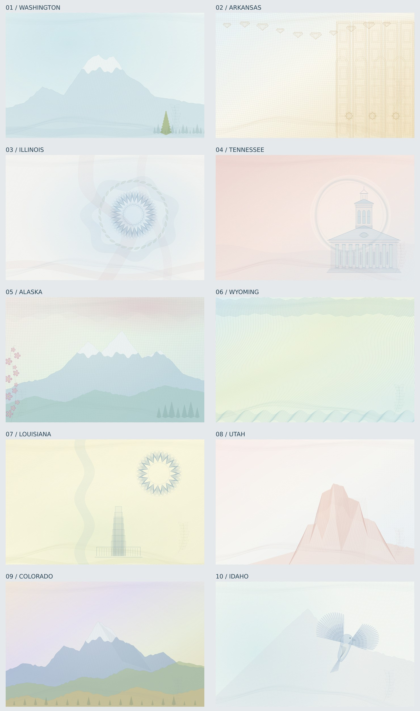

# draw.backgrounds

Ninety-five original, code-generated card backgrounds: 50 United States, 32 Mexican federal entities, and 13 Canadian provinces and territories. Public driver-license references and regional landscape/botanical studies inform the compositions; the source catalogs distinguish inspected specimens from reference gaps. Built in JavaScript with procedural SVG geometry and Sharp PNG export. The artwork contains no text, photographs, official seals or encoded data.



Expansion previews: [states 11–20](previews/us/contact-sheet-2.jpg) · [21–30](previews/us/contact-sheet-3.jpg) · [31–40](previews/us/contact-sheet-4.jpg) · [41–50](previews/us/contact-sheet-5.jpg).

## Documentation

[English guides](docs/agents/index.md) · [Guías en español](docs/es/index.md) · [Agent integration](AI_INTEGRATION_GUIDE.md) · [Website maintenance](docs/DOCUMENTATION.md)

The documentation website is built for [GitHub Pages](https://lambdawalker.github.io/draw.backgrounds/). It includes matching HTML and raw Markdown, reviewed artwork, and retained release scopes. Deployment becomes available after merging the documentation workflow and enabling Pages with GitHub Actions. Until an npm publication is confirmed in the catalog, the default scope is explicitly Development.

## Country collections

| Country | Designs | Gallery | Reference catalog |
|---|---:|---|---|
| United States | 50 | [US gallery](previews/us/README.md) | [US sources](references/us/) |
| Mexico | 32 | [Mexico gallery](previews/mx/README.md) | [Mexico sources](references/mx/) |
| Canada | 13 | [Canada gallery](previews/ca/README.md) | [Canada sources](references/ca/) |

[Mexico and Canada review history](docs/reviews/INTERNATIONAL.md) records the actual iterations, image checks, and remaining provenance limitations.

## Generate backgrounds

Requires Node.js 22 or newer. From the repository root:

```sh
npm ci
# All 95 designs, grouped in output/us, output/mx and output/ca.
npm run generate -- --country all --format both --out output
# Mexico only, three variations per entity.
npm run generate -- --country mx --count 3 --out output/mexico
# One Canadian province.
npm run generate -- --country ca --state quebec --out output/canada
# One SVG and PNG per state, plus a manifest (100 images total).
npm run generate -- --state all --seed 42 --format both --out output
# 5,000 PNG images: 100 variations of each of the fifty designs.
npm run generate -- --state all --count 100 --seed 1000 --format png --out output/dataset
# One state at a custom resolution.
npm run generate -- --state arkansas --width 1750 --height 1100 --format both --out output/arkansas
```

`--country` accepts `us`, `mx`, `ca`, or `all`. Explicit country selection writes country subfolders and a version-2 manifest containing country and jurisdiction keys. Omitting `--country` preserves the original flat US output and version-1 manifest. `--country all` requires `--state all`.

`--count` is **per jurisdiction**. Seeds increment for each variation. Each manifest item records state, seed, relative filenames and SHA-256 hashes. Repeated state/seed/dimensions produce identical SVG; PNG byte identity is expected within the same Sharp/libvips runtime. Raster encoders may differ between environments.

Use a new output directory for each batch: matching filenames and `manifest.json` are overwritten on reruns. A batch is written sequentially; disk/encoding failures may leave a partial batch. The manifest is written after successful generation.

Default dimensions are 1400 × 880. Geometry scales to the requested dimensions; a different aspect ratio intentionally stretches the design. Width and height must be positive integers up to 8192, with a maximum of 40 million pixels. `--seed` accepts unsigned 32-bit integers; the entire batch seed range must fit. `--count` accepts 1–10000. Run `npm run generate -- --help` for all options.

## Designs and downloads

| State | Composition | SVG | PNG | Visual passes |
|---|---|---|---|---|
| Washington | Ice-blue engraving, alpine ridge, evergreen | [SVG](previews/us/washington.svg) | [PNG](previews/us/washington.png) | 13 |
| Arkansas | Warped blue grid, gold panels and diamonds | [SVG](previews/us/arkansas.svg) | [PNG](previews/us/arkansas.png) | 13 |
| Illinois | Blue circular filigree and coral ribbons | [SVG](previews/us/illinois.svg) | [PNG](previews/us/illinois.png) | 13 |
| Tennessee | Coral field and engraved architectural pavilion | [SVG](previews/us/tennessee.svg) | [PNG](previews/us/tennessee.png) | 13 |
| Alaska | Mint peaks, pink flowers and interwoven header | [SVG](previews/us/alaska.svg) | [PNG](previews/us/alaska.png) | 13 |
| Wyoming | Green/cyan contour field and zigzag borders | [SVG](previews/us/wyoming.svg) | [PNG](previews/us/wyoming.png) | 12 |
| Louisiana | Warm yellow waves, blue rosette and stepped tower | [SVG](previews/us/louisiana.svg) | [PNG](previews/us/louisiana.png) | 13 |
| Utah | Coral canyon faces, etched strata and dotted edge | [SVG](previews/us/utah.svg) | [PNG](previews/us/utah.png) | 13 |
| Colorado | Lavender sky, blue peaks, sage/gold foothills | [SVG](previews/us/colorado.svg) | [PNG](previews/us/colorado.png) | 13 |
| Idaho | Cyan mesh, pale mountain and engraved bluebird | [SVG](previews/us/idaho.svg) | [PNG](previews/us/idaho.png) | 13 |

Pass counts include the final seed-variation regression check. Previews use seed 42. Seeds vary wave phases and, in landscape designs, ridge detail. An avalanche mix decorrelates consecutive seeds before the rendering PRNG runs. The principal motifs and palettes remain stable; seeds do not simulate different physical print processes or radically rearrange the composition.

## Remaining forty states

| State | SVG | PNG | Visual passes |
|---|---|---|---|
| Alabama | [SVG](previews/us/alabama.svg) | [PNG](previews/us/alabama.png) | 13 |
| Arizona | [SVG](previews/us/arizona.svg) | [PNG](previews/us/arizona.png) | 13 |
| California | [SVG](previews/us/california.svg) | [PNG](previews/us/california.png) | 13 |
| Connecticut | [SVG](previews/us/connecticut.svg) | [PNG](previews/us/connecticut.png) | 13 |
| Delaware | [SVG](previews/us/delaware.svg) | [PNG](previews/us/delaware.png) | 13 |
| Florida | [SVG](previews/us/florida.svg) | [PNG](previews/us/florida.png) | 13 |
| Georgia | [SVG](previews/us/georgia.svg) | [PNG](previews/us/georgia.png) | 13 |
| Hawaii | [SVG](previews/us/hawaii.svg) | [PNG](previews/us/hawaii.png) | 13 |
| Indiana | [SVG](previews/us/indiana.svg) | [PNG](previews/us/indiana.png) | 13 |
| Iowa | [SVG](previews/us/iowa.svg) | [PNG](previews/us/iowa.png) | 13 |
| Kansas | [SVG](previews/us/kansas.svg) | [PNG](previews/us/kansas.png) | 13 |
| Kentucky | [SVG](previews/us/kentucky.svg) | [PNG](previews/us/kentucky.png) | 13 |
| Maine | [SVG](previews/us/maine.svg) | [PNG](previews/us/maine.png) | 13 |
| Maryland | [SVG](previews/us/maryland.svg) | [PNG](previews/us/maryland.png) | 13 |
| Massachusetts | [SVG](previews/us/massachusetts.svg) | [PNG](previews/us/massachusetts.png) | 13 |
| Michigan | [SVG](previews/us/michigan.svg) | [PNG](previews/us/michigan.png) | 13 |
| Minnesota | [SVG](previews/us/minnesota.svg) | [PNG](previews/us/minnesota.png) | 13 |
| Mississippi | [SVG](previews/us/mississippi.svg) | [PNG](previews/us/mississippi.png) | 13 |
| Missouri | [SVG](previews/us/missouri.svg) | [PNG](previews/us/missouri.png) | 13 |
| Montana | [SVG](previews/us/montana.svg) | [PNG](previews/us/montana.png) | 13 |
| Nebraska | [SVG](previews/us/nebraska.svg) | [PNG](previews/us/nebraska.png) | 13 |
| Nevada | [SVG](previews/us/nevada.svg) | [PNG](previews/us/nevada.png) | 13 |
| New Hampshire | [SVG](previews/us/new-hampshire.svg) | [PNG](previews/us/new-hampshire.png) | 13 |
| New Jersey | [SVG](previews/us/new-jersey.svg) | [PNG](previews/us/new-jersey.png) | 13 |
| New Mexico | [SVG](previews/us/new-mexico.svg) | [PNG](previews/us/new-mexico.png) | 13 |
| New York | [SVG](previews/us/new-york.svg) | [PNG](previews/us/new-york.png) | 13 |
| North Carolina | [SVG](previews/us/north-carolina.svg) | [PNG](previews/us/north-carolina.png) | 13 |
| North Dakota | [SVG](previews/us/north-dakota.svg) | [PNG](previews/us/north-dakota.png) | 13 |
| Ohio | [SVG](previews/us/ohio.svg) | [PNG](previews/us/ohio.png) | 13 |
| Oklahoma | [SVG](previews/us/oklahoma.svg) | [PNG](previews/us/oklahoma.png) | 13 |
| Oregon | [SVG](previews/us/oregon.svg) | [PNG](previews/us/oregon.png) | 13 |
| Pennsylvania | [SVG](previews/us/pennsylvania.svg) | [PNG](previews/us/pennsylvania.png) | 13 |
| Rhode Island | [SVG](previews/us/rhode-island.svg) | [PNG](previews/us/rhode-island.png) | 13 |
| South Carolina | [SVG](previews/us/south-carolina.svg) | [PNG](previews/us/south-carolina.png) | 13 |
| South Dakota | [SVG](previews/us/south-dakota.svg) | [PNG](previews/us/south-dakota.png) | 13 |
| Texas | [SVG](previews/us/texas.svg) | [PNG](previews/us/texas.png) | 13 |
| Vermont | [SVG](previews/us/vermont.svg) | [PNG](previews/us/vermont.png) | 13 |
| Virginia | [SVG](previews/us/virginia.svg) | [PNG](previews/us/virginia.png) | 13 |
| West Virginia | [SVG](previews/us/west-virginia.svg) | [PNG](previews/us/west-virginia.png) | 13 |
| Wisconsin | [SVG](previews/us/wisconsin.svg) | [PNG](previews/us/wisconsin.png) | 13 |

## JavaScript API

The package exposes two ESM entry points for the same 95 jurisdictions.

| Import | Use |
| --- | --- |
| `@lambdawalker/draw-backgrounds` | SVG rendering and jurisdiction catalogs in Node.js or browser bundlers |
| `@lambdawalker/draw-backgrounds/canvas` | Raster rendering on Node.js through the optional native Canvas dependency |

See [installation](IMPORT.md) for Git tags and confirmed npm availability. See the [agent integration guide](docs/agents/index.md) for API contracts and troubleshooting.

```js
import { render, states, countries, jurisdictionsByCountry } from '@lambdawalker/draw-backgrounds';
import { writeFile } from 'node:fs/promises';

const svg = render('wyoming', { seed: 123, width: 1400, height: 880 });
await writeFile('wyoming.svg', svg);
const mexicoSvg = render("jalisco", { country: "mx", seed: 123 });
const canadaSvg = render("quebec", { country: "ca", seed: 123 });
console.log(states); // Legacy US catalog
console.log(countries, jurisdictionsByCountry);
```

The CLI, previews, and benchmarks run from the repository checkout. Sharp is a development dependency used for repository PNG export, tests, and benchmarks.

## Canvas renderer

The Node Canvas 2D renderer supports all 95 US, Mexican, and Canadian jurisdictions. Each design assembles named motif functions in layer order. Canvas and SVG share the motif geometry and seed handling. Canvas draws directly to a raster surface through `@napi-rs/canvas`.

```js
import { renderCanvas } from '@lambdawalker/draw-backgrounds/canvas';
import { writeFile } from 'node:fs/promises';

const canvas = renderCanvas('quebec', { country: 'ca', seed: 123, width: 1400, height: 880 });
await writeFile('quebec.png', await canvas.encode('png'));
```

## US rendering benchmark

```sh
npm ci
npm run benchmark:us -- --json us-benchmark.json
npm run benchmark:us -- --state wyoming --samples 20 --warmup 3 --width 700 --height 440
```

The benchmark runs matching seeds and sizes for each renderer, alternating execution order after warm-up. SVG draw time includes SVG generation and Sharp rasterization to RGBA. Canvas draw time includes surface creation, drawing, and access to the RGBA buffer. Both use the same Sharp PNG encoder in a separate measurement. File writes are outside the timed sections. The JSON report includes individual samples and per-state median, mean, and p95 in milliseconds.

[Full benchmark results for all 50 states](docs/US-RENDER-BENCHMARK.md).

## Organization

- `src/countries/`: jurisdiction compositions and country-specific helpers, grouped under `us`, `mx`, and `ca`. The US original designs and expansion groups follow the visual review history.
- `src/geometry.js`: shared warped grids, waves, guilloche, clipped hatching and illustrative motifs.
- `src/index.js`: jurisdiction catalog, drawing dispatch and SVG renderer. `src/public.js` defines the root package exports.
- `src/canvas.js`: Node Canvas drawing target and renderer.
- `src/cli.js`: file export, batch seeds, input validation and manifests.
- `scripts/previews.js`: regenerates the individual previews, country contact sheets and preview manifests.
- `references/us/sources.json`: the ten inspected specimen image URLs, source pages, edition labels and observed cues.
- [Reference study](docs/REFERENCES.md): how those cues informed original compositions.
- [Visual review log](docs/reviews/REVIEW.md): all review decisions and three refinement checkpoints and a final seed-variation check.

## Verification and maintenance

```sh
npm test
npm run format:check
npm run previews
npm run select-states
```

Tests check all 95 renders, deterministic SVG output, different-seed pixel variation, image dimensions, self-contained SVG content, batch seed assignment, file hashes and invalid CLI options. Regenerate previews after changing geometry. The initial ten selected states came from a reproducible seeded shuffle of all 50 states; the selection algorithm is in `scripts/select-states.js`.

The samples are visual references, including historical designs, not a claim about current credential formats. Reference images are linked but not redistributed or embedded. Generated artwork is deliberately stylized. Visual acceptance does not establish OCR/detector training accuracy; evaluate the generated dataset against your own held-out real images.

The earlier four finishing passes are documented in [the additional review log](docs/reviews/EXTRA.md), each with its own commit and contact sheet.

The remaining forty states have thirteen individually recorded visual passes (eight initial passes plus five further passes), with source snapshots, contact sheets, reference provenance and observations in [the expansion review](docs/reviews/EXPANSION.md). Mountain snowcaps now share the seeded ridge silhouette, so snow cannot invent peaks above the mountain edge.

Five additional passes across **all fifty states** are documented in the expansion snapshots (passes9–13) and [the original-ten review](docs/reviews/original-additional/). Original-ten checks include alternate seeds and reduced output sizes; accepted geometry is retained where no further change was justified.

## Publishing to npm

Push an immutable `vX.Y.Z` tag matching the version in the tagged `package.json`. See the [release and visual review runbook](docs/RELEASING.md) for authentication, validation, and retry steps.
