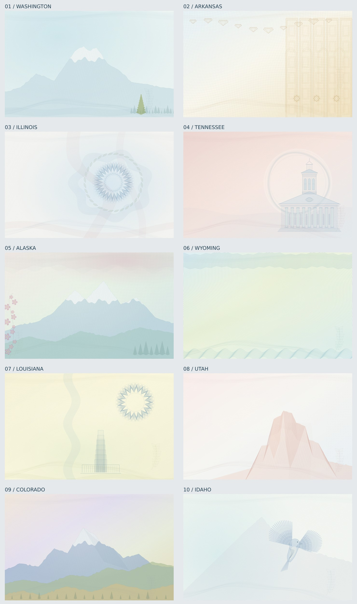

# draw.backgrounds

Fifty original, code-generated card backgrounds inspired by public US driver-license specimens. Built in JavaScript with procedural SVG geometry and Sharp PNG export. The artwork contains no text, photographs, official seals or encoded data.



Expansion previews: [states 11–20](previews/contact-sheet-2.jpg) · [21–30](previews/contact-sheet-3.jpg) · [31–40](previews/contact-sheet-4.jpg) · [41–50](previews/contact-sheet-5.jpg).

## Generate backgrounds

Requires Node.js 22 or newer. From the repository root:

```sh
npm ci
# One SVG and PNG per state, plus a manifest (100 images total).
npm run generate -- --state all --seed 42 --format both --out output
# 5,000 PNG images: 100 variations of each of the fifty designs.
npm run generate -- --state all --count 100 --seed 1000 --format png --out output/dataset
# One state at a custom resolution.
npm run generate -- --state arkansas --width 1750 --height 1100 --format both --out output/arkansas
```

`--count` is **per state**. Seeds increment for each variation. Each manifest item records state, seed, relative filenames and SHA-256 hashes. Repeated state/seed/dimensions produce identical SVG; PNG byte identity is expected within the same Sharp/libvips runtime. Raster encoders may differ between environments.

Use a new output directory for each batch: matching filenames and `manifest.json` are overwritten on reruns. A batch is written sequentially; disk/encoding failures may leave a partial batch. The manifest is written after successful generation.

Default dimensions are 1400 × 880. Geometry scales to the requested dimensions; a different aspect ratio intentionally stretches the design. Width and height must be positive integers up to 8192, with a maximum of 40 million pixels. `--seed` accepts unsigned 32-bit integers; the entire batch seed range must fit. `--count` accepts 1–10000. Run `npm run generate -- --help` for all options.

## Designs and downloads

| State | Composition | SVG | PNG | Visual passes |
|---|---|---|---|---|
| Washington | Ice-blue engraving, alpine ridge, evergreen | [SVG](previews/washington.svg) | [PNG](previews/washington.png) | 13 |
| Arkansas | Warped blue grid, gold panels and diamonds | [SVG](previews/arkansas.svg) | [PNG](previews/arkansas.png) | 13 |
| Illinois | Blue circular filigree and coral ribbons | [SVG](previews/illinois.svg) | [PNG](previews/illinois.png) | 13 |
| Tennessee | Coral field and engraved architectural pavilion | [SVG](previews/tennessee.svg) | [PNG](previews/tennessee.png) | 13 |
| Alaska | Mint peaks, pink flowers and interwoven header | [SVG](previews/alaska.svg) | [PNG](previews/alaska.png) | 13 |
| Wyoming | Green/cyan contour field and zigzag borders | [SVG](previews/wyoming.svg) | [PNG](previews/wyoming.png) | 12 |
| Louisiana | Warm yellow waves, blue rosette and stepped tower | [SVG](previews/louisiana.svg) | [PNG](previews/louisiana.png) | 13 |
| Utah | Coral canyon faces, etched strata and dotted edge | [SVG](previews/utah.svg) | [PNG](previews/utah.png) | 13 |
| Colorado | Lavender sky, blue peaks, sage/gold foothills | [SVG](previews/colorado.svg) | [PNG](previews/colorado.png) | 13 |
| Idaho | Cyan mesh, pale mountain and engraved bluebird | [SVG](previews/idaho.svg) | [PNG](previews/idaho.png) | 13 |

Pass counts include the final seed-variation regression check. Previews use seed 42. Seeds vary wave phases and, in landscape designs, ridge detail. An avalanche mix decorrelates consecutive seeds before the rendering PRNG runs. The principal motifs and palettes remain stable; seeds do not simulate different physical print processes or radically rearrange the composition.

## Remaining forty states

| State | SVG | PNG | Visual passes |
|---|---|---|---|
| Alabama | [SVG](previews/alabama.svg) | [PNG](previews/alabama.png) | 13 |
| Arizona | [SVG](previews/arizona.svg) | [PNG](previews/arizona.png) | 13 |
| California | [SVG](previews/california.svg) | [PNG](previews/california.png) | 13 |
| Connecticut | [SVG](previews/connecticut.svg) | [PNG](previews/connecticut.png) | 13 |
| Delaware | [SVG](previews/delaware.svg) | [PNG](previews/delaware.png) | 13 |
| Florida | [SVG](previews/florida.svg) | [PNG](previews/florida.png) | 13 |
| Georgia | [SVG](previews/georgia.svg) | [PNG](previews/georgia.png) | 13 |
| Hawaii | [SVG](previews/hawaii.svg) | [PNG](previews/hawaii.png) | 13 |
| Indiana | [SVG](previews/indiana.svg) | [PNG](previews/indiana.png) | 13 |
| Iowa | [SVG](previews/iowa.svg) | [PNG](previews/iowa.png) | 13 |
| Kansas | [SVG](previews/kansas.svg) | [PNG](previews/kansas.png) | 13 |
| Kentucky | [SVG](previews/kentucky.svg) | [PNG](previews/kentucky.png) | 13 |
| Maine | [SVG](previews/maine.svg) | [PNG](previews/maine.png) | 13 |
| Maryland | [SVG](previews/maryland.svg) | [PNG](previews/maryland.png) | 13 |
| Massachusetts | [SVG](previews/massachusetts.svg) | [PNG](previews/massachusetts.png) | 13 |
| Michigan | [SVG](previews/michigan.svg) | [PNG](previews/michigan.png) | 13 |
| Minnesota | [SVG](previews/minnesota.svg) | [PNG](previews/minnesota.png) | 13 |
| Mississippi | [SVG](previews/mississippi.svg) | [PNG](previews/mississippi.png) | 13 |
| Missouri | [SVG](previews/missouri.svg) | [PNG](previews/missouri.png) | 13 |
| Montana | [SVG](previews/montana.svg) | [PNG](previews/montana.png) | 13 |
| Nebraska | [SVG](previews/nebraska.svg) | [PNG](previews/nebraska.png) | 13 |
| Nevada | [SVG](previews/nevada.svg) | [PNG](previews/nevada.png) | 13 |
| New Hampshire | [SVG](previews/new-hampshire.svg) | [PNG](previews/new-hampshire.png) | 13 |
| New Jersey | [SVG](previews/new-jersey.svg) | [PNG](previews/new-jersey.png) | 13 |
| New Mexico | [SVG](previews/new-mexico.svg) | [PNG](previews/new-mexico.png) | 13 |
| New York | [SVG](previews/new-york.svg) | [PNG](previews/new-york.png) | 13 |
| North Carolina | [SVG](previews/north-carolina.svg) | [PNG](previews/north-carolina.png) | 13 |
| North Dakota | [SVG](previews/north-dakota.svg) | [PNG](previews/north-dakota.png) | 13 |
| Ohio | [SVG](previews/ohio.svg) | [PNG](previews/ohio.png) | 13 |
| Oklahoma | [SVG](previews/oklahoma.svg) | [PNG](previews/oklahoma.png) | 13 |
| Oregon | [SVG](previews/oregon.svg) | [PNG](previews/oregon.png) | 13 |
| Pennsylvania | [SVG](previews/pennsylvania.svg) | [PNG](previews/pennsylvania.png) | 13 |
| Rhode Island | [SVG](previews/rhode-island.svg) | [PNG](previews/rhode-island.png) | 13 |
| South Carolina | [SVG](previews/south-carolina.svg) | [PNG](previews/south-carolina.png) | 13 |
| South Dakota | [SVG](previews/south-dakota.svg) | [PNG](previews/south-dakota.png) | 13 |
| Texas | [SVG](previews/texas.svg) | [PNG](previews/texas.png) | 13 |
| Vermont | [SVG](previews/vermont.svg) | [PNG](previews/vermont.png) | 13 |
| Virginia | [SVG](previews/virginia.svg) | [PNG](previews/virginia.png) | 13 |
| West Virginia | [SVG](previews/west-virginia.svg) | [PNG](previews/west-virginia.png) | 13 |
| Wisconsin | [SVG](previews/wisconsin.svg) | [PNG](previews/wisconsin.png) | 13 |

## JavaScript API

The SVG renderer has no dependencies and can also run in browser modules. Import it directly from the checkout (the package is not published):

```js
import { render, states } from './src/index.js';
import { writeFile } from 'node:fs/promises';

const svg = render('wyoming', { seed: 123, width: 1400, height: 880 });
await writeFile('wyoming.svg', svg);
console.log(states);
```

Only CLI PNG export and preview generation require Sharp. `node src/cli.js --format svg` can run without installing dependencies.

## Organization

- `src/designs/`: the original ten composition modules.
- `src/expansion/`: forty additional compositions and reusable regional illustration helpers.
- `src/geometry.js`: shared warped grids, waves, guilloche, clipped hatching and illustrative motifs.
- `src/index.js`: deterministic renderer and supported-state registry.
- `src/cli.js`: file export, batch seeds, input validation and manifests.
- `scripts/previews.js`: regenerates the individual previews, five contact sheets and preview manifest.
- `references/sources.json`: the ten inspected specimen image URLs, source pages, edition labels and observed cues.
- [Reference study](docs/REFERENCES.md): how those cues informed original compositions.
- [Visual review log](docs/reviews/REVIEW.md): all review decisions and three refinement checkpoints and a final seed-variation check.

## Verification and maintenance

```sh
npm test
npm run format:check
npm run previews
npm run select-states
```

Tests check all fifty renders, deterministic SVG output, different-seed pixel variation, image dimensions, self-contained SVG content, batch seed assignment, file hashes and invalid CLI options. Regenerate previews after changing geometry. The initial ten selected states came from a reproducible seeded shuffle of all 50 states; the selection algorithm is in `scripts/select-states.js`.

The samples are visual references, including historical designs, not a claim about current credential formats. Reference images are linked but not redistributed or embedded. Generated artwork is deliberately stylized. Visual acceptance does not establish OCR/detector training accuracy; evaluate the generated dataset against your own held-out real images.

The earlier four finishing passes are documented in [the additional review log](docs/reviews/EXTRA.md), each with its own commit and contact sheet.

The remaining forty states have thirteen individually recorded visual passes (eight initial passes plus five further passes), with source snapshots, contact sheets, reference provenance and observations in [the expansion review](docs/reviews/EXPANSION.md). Mountain snowcaps now share the seeded ridge silhouette, so snow cannot invent peaks above the mountain edge.

Five additional passes across **all fifty states** are documented in the expansion snapshots (passes9–13) and [the original-ten review](docs/reviews/original-additional/). Original-ten checks include alternate seeds and reduced output sizes; accepted geometry is retained where no further change was justified.
