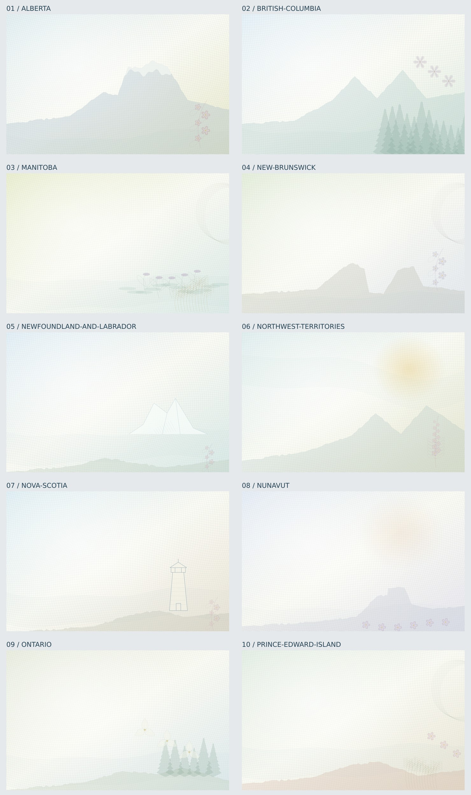

# Canada backgrounds

13 original procedural designs. Seed 42, 1400 × 880. [All countries](../README.md).

[Contact sheet 1](contact-sheet.jpg) · [Contact sheet 2](contact-sheet-2.jpg)

| Jurisdiction | SVG | PNG |
|---|---|---|
| alberta | [SVG](alberta.svg) | [PNG](alberta.png) |
| british columbia | [SVG](british-columbia.svg) | [PNG](british-columbia.png) |
| manitoba | [SVG](manitoba.svg) | [PNG](manitoba.png) |
| new brunswick | [SVG](new-brunswick.svg) | [PNG](new-brunswick.png) |
| newfoundland and labrador | [SVG](newfoundland-and-labrador.svg) | [PNG](newfoundland-and-labrador.png) |
| northwest territories | [SVG](northwest-territories.svg) | [PNG](northwest-territories.png) |
| nova scotia | [SVG](nova-scotia.svg) | [PNG](nova-scotia.png) |
| nunavut | [SVG](nunavut.svg) | [PNG](nunavut.png) |
| ontario | [SVG](ontario.svg) | [PNG](ontario.png) |
| prince edward island | [SVG](prince-edward-island.svg) | [PNG](prince-edward-island.png) |
| quebec | [SVG](quebec.svg) | [PNG](quebec.png) |
| saskatchewan | [SVG](saskatchewan.svg) | [PNG](saskatchewan.png) |
| yukon | [SVG](yukon.svg) | [PNG](yukon.png) |

