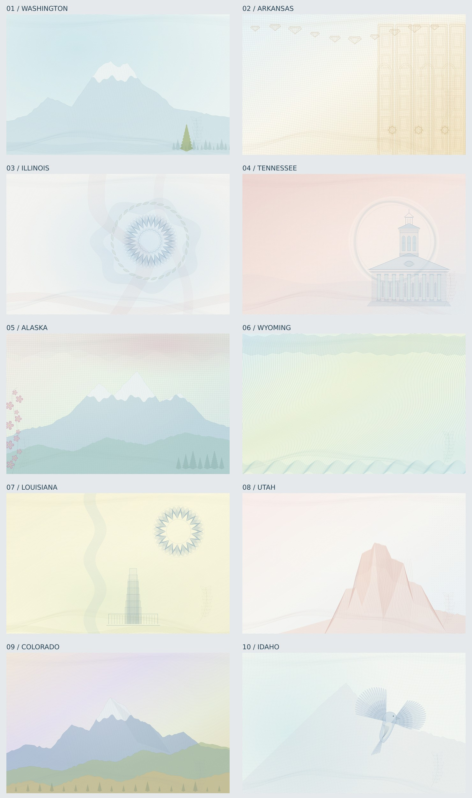

# United States backgrounds

50 original procedural designs. Seed 42, 1400 × 880. [All countries](../README.md).

[Contact sheet 1](contact-sheet.jpg) · [Contact sheet 2](contact-sheet-2.jpg) · [Contact sheet 3](contact-sheet-3.jpg) · [Contact sheet 4](contact-sheet-4.jpg) · [Contact sheet 5](contact-sheet-5.jpg)

| Jurisdiction | SVG | PNG |
|---|---|---|
| washington | [SVG](washington.svg) | [PNG](washington.png) |
| arkansas | [SVG](arkansas.svg) | [PNG](arkansas.png) |
| illinois | [SVG](illinois.svg) | [PNG](illinois.png) |
| tennessee | [SVG](tennessee.svg) | [PNG](tennessee.png) |
| alaska | [SVG](alaska.svg) | [PNG](alaska.png) |
| wyoming | [SVG](wyoming.svg) | [PNG](wyoming.png) |
| louisiana | [SVG](louisiana.svg) | [PNG](louisiana.png) |
| utah | [SVG](utah.svg) | [PNG](utah.png) |
| colorado | [SVG](colorado.svg) | [PNG](colorado.png) |
| idaho | [SVG](idaho.svg) | [PNG](idaho.png) |
| alabama | [SVG](alabama.svg) | [PNG](alabama.png) |
| arizona | [SVG](arizona.svg) | [PNG](arizona.png) |
| california | [SVG](california.svg) | [PNG](california.png) |
| connecticut | [SVG](connecticut.svg) | [PNG](connecticut.png) |
| delaware | [SVG](delaware.svg) | [PNG](delaware.png) |
| florida | [SVG](florida.svg) | [PNG](florida.png) |
| georgia | [SVG](georgia.svg) | [PNG](georgia.png) |
| hawaii | [SVG](hawaii.svg) | [PNG](hawaii.png) |
| indiana | [SVG](indiana.svg) | [PNG](indiana.png) |
| iowa | [SVG](iowa.svg) | [PNG](iowa.png) |
| kansas | [SVG](kansas.svg) | [PNG](kansas.png) |
| kentucky | [SVG](kentucky.svg) | [PNG](kentucky.png) |
| maine | [SVG](maine.svg) | [PNG](maine.png) |
| maryland | [SVG](maryland.svg) | [PNG](maryland.png) |
| massachusetts | [SVG](massachusetts.svg) | [PNG](massachusetts.png) |
| michigan | [SVG](michigan.svg) | [PNG](michigan.png) |
| minnesota | [SVG](minnesota.svg) | [PNG](minnesota.png) |
| mississippi | [SVG](mississippi.svg) | [PNG](mississippi.png) |
| missouri | [SVG](missouri.svg) | [PNG](missouri.png) |
| montana | [SVG](montana.svg) | [PNG](montana.png) |
| nebraska | [SVG](nebraska.svg) | [PNG](nebraska.png) |
| nevada | [SVG](nevada.svg) | [PNG](nevada.png) |
| new hampshire | [SVG](new-hampshire.svg) | [PNG](new-hampshire.png) |
| new jersey | [SVG](new-jersey.svg) | [PNG](new-jersey.png) |
| new mexico | [SVG](new-mexico.svg) | [PNG](new-mexico.png) |
| new york | [SVG](new-york.svg) | [PNG](new-york.png) |
| north carolina | [SVG](north-carolina.svg) | [PNG](north-carolina.png) |
| north dakota | [SVG](north-dakota.svg) | [PNG](north-dakota.png) |
| ohio | [SVG](ohio.svg) | [PNG](ohio.png) |
| oklahoma | [SVG](oklahoma.svg) | [PNG](oklahoma.png) |
| oregon | [SVG](oregon.svg) | [PNG](oregon.png) |
| pennsylvania | [SVG](pennsylvania.svg) | [PNG](pennsylvania.png) |
| rhode island | [SVG](rhode-island.svg) | [PNG](rhode-island.png) |
| south carolina | [SVG](south-carolina.svg) | [PNG](south-carolina.png) |
| south dakota | [SVG](south-dakota.svg) | [PNG](south-dakota.png) |
| texas | [SVG](texas.svg) | [PNG](texas.png) |
| vermont | [SVG](vermont.svg) | [PNG](vermont.png) |
| virginia | [SVG](virginia.svg) | [PNG](virginia.png) |
| west virginia | [SVG](west-virginia.svg) | [PNG](west-virginia.png) |
| wisconsin | [SVG](wisconsin.svg) | [PNG](wisconsin.png) |

